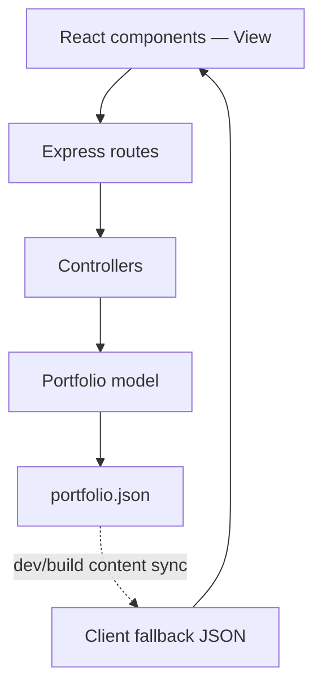

# Portfolio architecture

## Stack

| Layer                  | Technology                                       | Responsibility                                                |
| ---------------------- | ------------------------------------------------ | ------------------------------------------------------------- |
| View                   | React 19 + Vite 8                                | Components, application state, and client build               |
| Styling                | Vanilla CSS                                      | Responsive layouts, themes, typography, and decorative motion |
| Motion                 | GSAP 3.15                                        | ScrollSmoother, ScrollTrigger, entrance and skill transitions |
| Controller and routing | Node.js + Express 5                              | Public content endpoints and response handling                |
| Model                  | Local JSON and a small model module              | Read-only portfolio content                                   |
| Testing                | Node test runner, Vitest, Testing Library, jsdom | API behavior and React interactions                           |

The backend uses MVC organization. React is the **View**, Express controller functions are the **Controllers**, and `portfolio.model.js` is the **Model**. A separate server-side template engine is unnecessary for this client-rendered application.

## Request and data flow

1. React immediately renders the bundled content, avoiding an empty screen while a server starts.
2. `usePortfolio` calls `portfolioApi.js`, requesting `GET /api/v1/portfolio`.
3. Express matches the route and invokes the controller.
4. The controller requests the data from the model and returns JSON.
5. React updates its content after a successful response. If the server is missing, slow, or returns an invalid payload, the local content remains visible.

The fetch has a five-second timeout and is aborted on unmount. Content requests are read-only. The client has no credentials, authentication flow, or database connection.

## Why this backend is small

This portfolio displays public content and opens email links. A JSON-backed model serves those requirements without database setup. If you later want editable content, replace the model's data access with MongoDB queries while retaining the controller and route boundaries. Add authentication only when introducing private editing or another operation that needs it.

There is one canonical editable data file: `server/src/data/portfolio.json`. The checked-in client copy is a static fallback. `sync-content.mjs` keeps the two copies equal before root-level development and production builds.

## Component boundaries

| Component or hook                           | Owns                                                       |
| ------------------------------------------- | ---------------------------------------------------------- |
| `App`                                       | Page assembly and the selected project                     |
| `PreferencesProvider`                       | Theme and motion settings, including OS reduced motion     |
| `Header`                                    | Navigation and mobile-menu state                           |
| `Hero`                                      | Introduction and animated display name                     |
| `TechRibbon`                                | Eight local logos and the repeating strip                  |
| `SelectedWork` / `ProjectCard`              | Project cards and their navigation                         |
| `HyperClipPreview` / `CampusPreview`        | Original decorative interface concepts                     |
| `ProjectDialog`                             | Accessible project details and real destination links      |
| `Skills`                                    | Selected skill and its description                         |
| `About`, `Education`, `Profiles`, `Contact` | Their individual page sections                             |
| `usePortfolio`                              | API refresh plus local fallback                            |
| `usePortfolioMotion`                        | Smooth scrolling, GSAP reveal lifecycle, anchor navigation |
| `usePointerTilt`                            | Desktop hover tilt, with listener cleanup                  |

Reusable content is rendered from data with `.map()`. JSX is explicit and does not inject HTML strings. Existing design class names are retained to preserve the final appearance.

## Motion and scrolling

`#smooth-wrapper` contains `#smooth-content`. On a desktop-sized viewport with a precise pointer, ScrollSmoother applies a short catch-up effect to native scrolling. On touch devices, the site uses native scrolling. ScrollTrigger handles section reveals, and GSAP animates the hero letters and selected skill copy.

Viewport-fixed elements, the skip link, grain layer, and scroll progress sit outside the transformed content. The project dialog is rendered through a React portal into `document.body`, pauses the smoother while open, and restores scroll and focus when closed.

Effects use `gsap.context()` and `gsap.matchMedia()` cleanup so unmounts, content refreshes, preference changes, and React StrictMode do not accumulate listeners or animations. Turning animation off removes smoothing and reveal effects. The CSS logo strip also pauses; its content becomes manually scrollable.

CSS is responsible for decorative motion such as floating previews, the logo strip, and hover effects. This keeps GSAP usage focused on scrolling and coordinated transitions.

## Local and production URLs

During development, Vite receives requests at port 5173 and proxies `/api` to Express at port 5000. The browser sees same-origin requests. In the combined production mode, Express serves the built client and `/api` from the same host.

For separate hosting, set `VITE_API_BASE_URL` before building and configure the backend's `CLIENT_ORIGIN`. Only the public API origin is exposed to the client.

## Error handling and serving

The server provides controlled 400/404/500 JSON responses. Unknown API paths never fall through to the client. Helmet supplies security headers; the content security policy allows the app's own scripts and the optional Google Fonts CSS/font resources. The early theme initializer is an external script so production CSP does not block it.

The static page has no router dependency because it is one document with section anchors. Express serves the built root page directly. Paths that do not exist return 404.

## Useful next changes

| Goal                                | Where to edit                                                 |
| ----------------------------------- | ------------------------------------------------------------- |
| Add Instagram or Twitter/X          | `profiles` objects in the main JSON, then sync                |
| Change project descriptions or URLs | `projects` objects in the main JSON                           |
| Change objective or email           | `profile` object in the main JSON                             |
| Restyle the site                    | `client/src/styles/portfolio.css`                             |
| Adjust scroll smoothing             | `smooth` in `usePortfolioMotion.js`                           |
| Add a server feature                | New route, controller, and model function under `server/src/` |

The hosted portfolio is not modified by this export. This folder is the standalone React/Express source distribution of that design.
